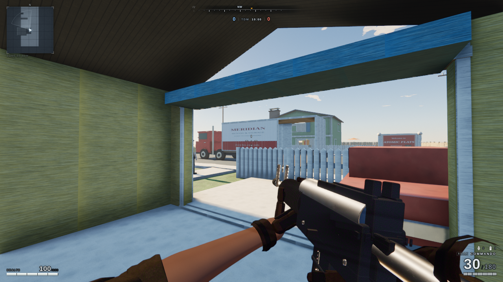

# Natural

<!-- generated:badges:start -->

[](https://github.com/toma/natural/actions/workflows/ci.yml)
[](https://github.com/toma/natural/actions/workflows/codeql.yml)
[](https://github.com/toma/natural/actions/workflows/performance.yml)
[](https://github.com/toma/natural/actions/workflows/release.yml)
[](https://www.npmjs.com/package/@toma.com/natural)
[](https://www.npmjs.com/package/@toma.com/natural)
[](LICENSE)
[](https://bun.sh)
<!-- generated:badges:end -->

Natural is a desktop-quality 2D and 3D game engine in the class of Unity and Unreal Engine, and it
runs in the browser. It is MIT-licensed, code-first, and written for TypeScript. It combines Bun's
toolchain and authoritative server runtime with Three.js WebGPU/WebGL rendering, Rapier physics, a
deterministic ECS, and browser and Tauri editors.

The umbrella package is `@toma.com/natural`; the installed executable is `natural`. The current
release is a production-tested vertical slice. The implemented and planned surface is tracked in
[the capability matrix](docs/capability-matrix.md).

## Run the demo

With Bun installed, run this from the repository root:

```bash
bun run demo
```

This installs the locked dependencies and starts [NaturalFPS](examples/urban-raid/README.md).
Open http://127.0.0.1:43400 to play. Press Ctrl+C in the terminal to stop the server.



The demo map is Atomic Cul-de-sac: a small, symmetrical suburban cul-de-sac with two facing
two-story houses, a central school bus and moving truck, picket fences, parked vintage cars, and a
desert-mountain horizon. Every surface is generated by the engine at load time.

## Create a game

From a published release:

```bash
bunx @toma.com/cli create my-game
cd my-game
bun install
bun run dev
```

From this repository:

```bash
bun install --frozen-lockfile
bun natural create my-game
cd my-game
bun run dev
```

The generated project contains a playable 3D scene, an authoritative Bun server, a unit test,
web/desktop exports, project metadata, and instructions for both human contributors and AI agents.

## Included systems

- Generation-safe ECS entities, deterministic fixed ticks, ordered systems, resources, signals,
  scene trees, stable UUIDs, migrations, saves, input maps, seeded randomness, and profiling.
- WebGPU-first Three.js renderer with WebGL 2 fallback, 2D sprites and tilemaps, 3D PBR meshes,
  lights, cameras, particles, terrain, and cached instancing up to one million visible objects.
- Rapier 2D and 3D rigid bodies, colliders, sensors, collision signals, ray casts, impulses, and
  kinematic synchronization.
- Animation clips, browser input, spatial Web Audio, DOM UI, localization, A* grid navigation, and
  hysteretic world streaming.
- Bun authoritative multiplayer with binary schemas, interest management, prediction and
  reconciliation, replay recording, authentication hooks, reconnectable sessions, packet limits,
  and a measured 256-client test.
- Browser editor plus a native Tauri desktop shell with project selection, scene hierarchy editing,
  components, undo/redo, atomic saves, and live browser preview.
- Content-addressed assets, runtime/editor plugin manifests, a noninteractive CLI, an MCP server,
  deterministic test helpers, clean-room package tests, and web/server/desktop exporters.

<!-- generated:packages:start -->

## Published packages

Every public package is released together from the same version tag.

| Package                                                                      | Purpose                                                                                                                                                     | Version         |
| ---------------------------------------------------------------------------- | ----------------------------------------------------------------------------------------------------------------------------------------------------------- | --------------- |
| [`@toma.com/assets`](https://www.npmjs.com/package/@toma.com/assets)         | Content-addressed asset import pipeline for the Natural game engine                                                                                         | `0.1.0-alpha.4` |
| [`@toma.com/cli`](https://www.npmjs.com/package/@toma.com/cli)               | Project creation, development, inspection, testing, and export CLI for Natural                                                                              | `0.1.0-alpha.4` |
| [`@toma.com/core`](https://www.npmjs.com/package/@toma.com/core)             | Deterministic ECS, scenes, resources, and runtime lifecycle for Natural                                                                                     | `0.1.0-alpha.4` |
| [`@toma.com/gameplay`](https://www.npmjs.com/package/@toma.com/gameplay)     | Animation, input, audio, UI, localization, navigation, and streaming for Natural                                                                            | `0.1.0-alpha.4` |
| [`@toma.com/mcp`](https://www.npmjs.com/package/@toma.com/mcp)               | Local Model Context Protocol server for Natural engine projects                                                                                             | `0.1.0-alpha.4` |
| [`@toma.com/natural`](https://www.npmjs.com/package/@toma.com/natural)       | Desktop-quality 2D and 3D game engine in the class of Unity and Unreal Engine that runs in the browser, built on Bun, WebGPU, and authoritative multiplayer | `0.1.0-alpha.4` |
| [`@toma.com/netcode`](https://www.npmjs.com/package/@toma.com/netcode)       | Authoritative multiplayer, prediction, replication, and replays for Natural                                                                                 | `0.1.0-alpha.4` |
| [`@toma.com/physics`](https://www.npmjs.com/package/@toma.com/physics)       | GPU-friendly Rapier 2D and 3D physics integration for Natural                                                                                               | `0.1.0-alpha.4` |
| [`@toma.com/plugin-sdk`](https://www.npmjs.com/package/@toma.com/plugin-sdk) | Manifest and extension SDK for Natural engine plugins                                                                                                       | `0.1.0-alpha.4` |
| [`@toma.com/render`](https://www.npmjs.com/package/@toma.com/render)         | WebGPU-first 2D and 3D rendering for Natural, powered by Three.js                                                                                           | `0.1.0-alpha.4` |
| [`@toma.com/test`](https://www.npmjs.com/package/@toma.com/test)             | Deterministic headless testing utilities for Natural games                                                                                                  | `0.1.0-alpha.4` |

<!-- generated:packages:end -->

## Scale contract

Natural treats visible and actively simulated objects as different budgets:

- 1,000,000 visible static instances in one GPU-instanced scene on the dedicated WebGPU runner.
- 10,000 active ECS entities updated inside a 16.7 ms p95 CPU budget.
- 256 connected authoritative clients inside a 33.3 ms p95 server budget.

Hardware-specific GPU performance is tested only on the `natural-gpu` runner. Hosted CI runs the
editor, all three reference games, visual regression, package installation, and CPU/network gates.

## Repository commands

```bash
bun run check          # version sites, copy rules, formatting, types, lint, tests, coverage
bun run build          # libraries, declarations, editor, and reference games
bun run pack:check     # npm tarballs and clean-room consumer/generated-project smoke tests
bun run test:e2e       # editor and real browser game loops
bun run test:network   # 256-client authoritative-server benchmark
bun run bench          # 10,000-active-entity CPU benchmark
bun run version:bump   # rewrite every version site: patch, minor, major, prerelease, or X.Y.Z
bun run release:verify # every release gate, including dependency audit
```

Run the reference games directly with:

```bash
bun run --filter @toma.com/example-arena-2d dev
bun run --filter @toma.com/example-sandbox-3d dev
bun run demo
```

The FPS example at http://127.0.0.1:43400 is [NaturalFPS](examples/urban-raid/README.md).
Click its canvas to capture the mouse for first-person controls.

See [architecture](docs/architecture.md), [testing](docs/testing.md),
[contributing](CONTRIBUTING.md), [release process](docs/releasing.md), and the
[capability matrix](docs/capability-matrix.md).

## Release status

Every push to `main` checks the repository version. A new version creates an immutable tag and starts
the release workflow, which publishes the public packages and builds the desktop applications. Stable
versions use the npm `latest` tag, and prereleases use `next`. See the [release process](docs/releasing.md)
for credentials, reruns, and failure recovery.

<!-- generated:contributions:start -->

## Contribution paths

Start with [CONTRIBUTING.md](CONTRIBUTING.md), then use the path that matches the change.

| Area          | Start here                                             | Validation                                 |
| ------------- | ------------------------------------------------------ | ------------------------------------------ |
| Code          | [Packages](packages)                                   | `bun run check`                            |
| Tests         | [Testing guide](docs/testing.md)                       | `bun run test`                             |
| Documentation | [Documentation](docs)                                  | `bun run docs:check`                       |
| Examples      | [Examples](examples)                                   | `bun run build` and `bun run test:e2e`     |
| Performance   | [Performance gates](docs/testing.md#performance-gates) | `bun run test:network` and `bun run bench` |
| Security      | [Security policy](SECURITY.md)                         | Follow the private reporting process       |

<!-- generated:contributions:end -->
